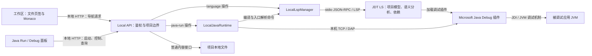
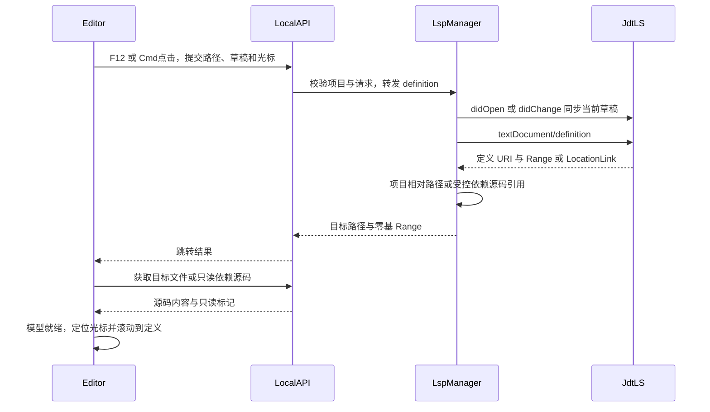
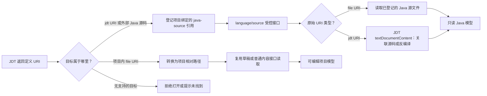
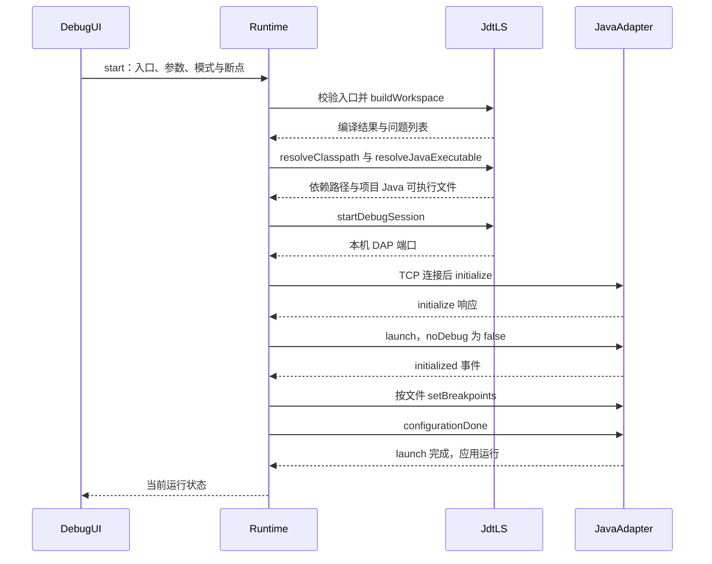
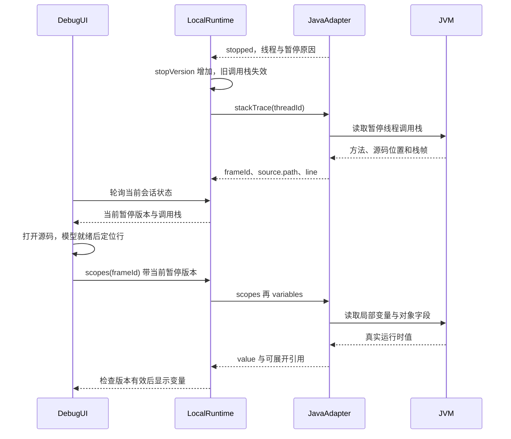
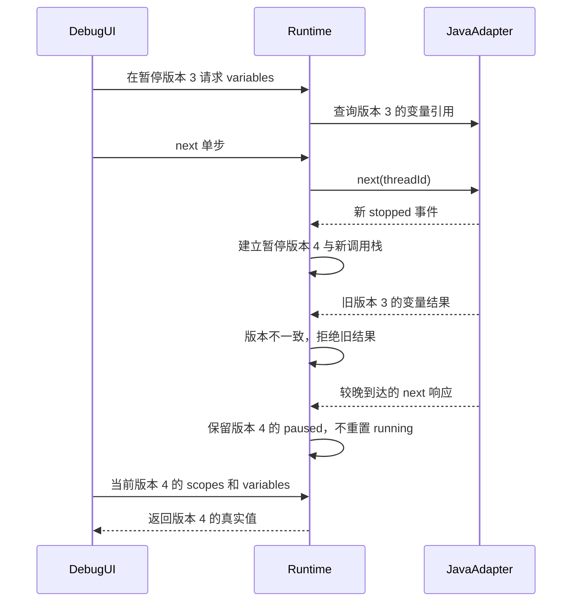

# 代码编辑器：检索、代码导航与桌面 Java Debug

本文前半部分说明网页版的浏览器索引与远程 LSP 控制面；后半部分说明已经实现的桌面 Local API / LSP / Java DAP 链路。两者复用 Monaco 和交互约定，但运行实例、路径边界和权限模型不同，不能把网页版“尚未启动 LSP Worker”的限制套用到桌面版。

阅读建议：先看文末的[原理详解与交互图](#原理详解与交互图)，再回到接口、实现入口和排障部分。图中的架构和示例以当前桌面代码为准；示例类名、帧号及变量引用是解释用数据，不是固定协议值。

## 目标与当前能力

在线编辑器以“用户工作区 + Git 分支”为数据边界。浏览器只会索引当前会话对应工作区中的源码，因此不同用户、不同分支之间不会共享文件内容或 Monaco 模型。

当前提供以下能力：

- 文件名与源码正文的全局字面量搜索，入口位于文件树上方，快捷键为 `Cmd/Ctrl+Shift+F`；正文结果可直接定位到行、列。
- TypeScript/JavaScript 项目级 Monaco 模型同步，使相对路径导入、变量定义跳转和引用查找能够跨文件工作。
- 已打开文件的未保存草稿优先进入语言服务，避免代码导航仍指向旧磁盘内容。
- 当前文档及其他已索引文档参与单词补全。

## API 与权限边界

| API | 用途 | 权限 |
| --- | --- | --- |
| `GET /sessions/:id/files/index` | 返回受限源码模型供浏览器语言服务使用 | 登录 + `project:read` + 会话/项目访问校验 |
| `GET /sessions/:id/files/search?query=...` | 搜索文件路径和源码正文 | 登录 + `project:read` + 会话/项目访问校验 |

两个接口都通过会话解析用户工作区，不接受客户端传入物理目录。路径继续经过工作区路径和符号链接校验。

为避免大仓库拖垮 API 或浏览器，源码索引限制为单文件 256 KiB、总计 4 MiB、最多 300 个模型；全文搜索最多扫描 10 MiB，并最多返回 200 条结果。依赖目录、构建产物、Git 元数据、隐藏文件和二进制文件不参与扫描。达到边界时接口返回 `truncated: true`，界面提示缩小关键词。

## 已知边界

Monaco 浏览器内置语言服务只对 TypeScript/JavaScript 提供语义级分析。网页端现已接入服务器 REST 语言服务，Java、Python、C/C++、Vue 等不再依赖浏览器内置分析；Go/Rust 需要服务器另行安装 gopls/rust-analyzer。关闭服务器语言服务时仍保留高亮、搜索和 TS/JS 浏览器索引回退。

大仓库、依赖符号、路径别名以及生成代码可能因索引上限或缺少依赖类型声明而无法跳转。当前关闭 TS/JS 语义诊断是为了避免未安装依赖类型时产生大量误报，但这也意味着编辑器不会展示完整的类型错误。

## 后续演进

### 已完成：通用控制面

API 已提供语言服务会话控制面：

- `POST /sessions/:sessionId/lsp/sessions` 创建语言服务会话并签发 256 bit 短期一次性票据。
- `GET /sessions/:sessionId/lsp/sessions/:id` 查询当前用户自己的会话状态。
- `DELETE /sessions/:sessionId/lsp/sessions/:id` 关闭当前用户自己的会话。
- Redis 保存短期会话和路由元数据，API Pod 不持有本地会话状态，可进行多副本部署。
- 工作区键由租户、用户、项目和分支生成；服务端记录真实工作区路径，但不会返回给浏览器。
- 原始连接票据不落库、不写 Redis，只保存 SHA-256 摘要，并通过原子 `GETDEL` 保证只能消费一次。
- 票据不放入 WebSocket URL，避免被 Ingress、代理和访问日志记录；后续客户端应在连接后的首条认证消息中提交票据。

功能开关 `LSP_ENABLED` 默认关闭。上面的 WebSocket 会话控制面仍是预留基础，并不代表 WebSocket Worker 数据面已完成。网页端已经实现下面的 REST 数据面，部署好语言组件和工作区挂载后可启用。一次性票据的 60 秒过期和 Redis 会话的 30 分钟过期只适用于预留 WebSocket 接口，不用于 REST 跳转。

### 已完成：网页端 REST 代码智能

网页与桌面共用 `packages/code-intelligence` 中的语言服务管理器、路径规范化、文档同步和 Java 虚拟源码实现。桌面由 Local API 调用；网页由 Nest API 调用。两端的运行实例、索引缓存和工作区文件独立，网页不会读取浏览器所在机器的目录。

- `POST /sessions/:sessionId/language/prepare`：预热并返回各语言组件的就绪状态。
- `POST /sessions/:sessionId/language/:operation`：定义、声明、类型定义、实现、引用、悬浮、补全、诊断、文档/工作区符号、重命名编辑预览、快速修复和调用层级。
- `GET /sessions/:sessionId/language/source?path=@java-source/...`：打开 JDT 返回的 JAR/JDK 只读源码。此接口只接受先前定义请求注册的虚拟引用，不接受任意 `file://`、JAR URI 或绝对路径。

请求以 1 开始的 `line`/`column` 描述光标；结果沿用 LSP 以 0 开始的 `range` 或 `targetSelectionRange`，并把服务器 URI 转为工作区相对 `path`。前端统一转回 Monaco 坐标。TypeScript 普通定义可能停在 import 别名，因此共用运行时优先使用 `_typescript.goToSourceDefinition` 查找真实源码，失败时回退普通定义。

API 使用现有 JWT、`project:read` 和数据库项目角色校验。重命名/快速修复编辑预览额外要求项目 `edit` 能力；预览只返回编辑建议，不直接写文件。真实文件读取仍走已有文件 API，保存仍走已有保存权限校验。路径 realpath 检查阻止 `..`、绝对路径和外部符号链接。运行时/文件系统错误不会向浏览器返回服务器绝对路径。

语言实例键是用户、项目、真实工作区根目录和分支的 SHA-256 摘要，同一用户同一工作区的多个任务会话复用进程，其他用户不共享未保存文档。每个实例空闲十分钟后关闭；当前每个 API 进程最多 32 个语言实例，Java 单实例上限 1 GiB，部署时必须按同时活跃项目规划内存。API 退出时关闭子进程，守护进程也处理父进程意外退出。

请求携带当前文件内容及其他未保存的语言文件（最多 20 个，总请求限制约 1 MB）。服务端按用户工作区串行同步再查询，不保存这些缓冲区。返回前再次检查项目权限和分支；前端还检查请求序号、当前文件和文档版本，避免迟到结果把用户带回旧文件。

网页 F12 / Ctrl(Cmd)+点击直接请求服务器定义，先把目标文件放入 React Query 缓存，再激活标签。Monaco 不再以文件路径作为 React key 重建实例，使用独立 model 和视图状态保存位置。只在目标内容和 model 都就绪后定位并聚焦。Monaco 的引用/实现等内置导航通过 editor opener 进入同一文件缓存和标签链路。虚拟 Java 源码禁用编辑、保存和自动格式化。服务器语言服务可用时不再下载整个浏览器源码索引，仅按需读取目标文件。

部署步骤：

1. `npm ci` 安装共用语言服务依赖；服务器安装 JDK 21 或更高版本。
2. `npm run prepare-language-servers --workspace apps/api` 下载并校验固定版本 JDT LS、Lombok 和 Java 插件。默认安装到 `packages/code-intelligence/.cache`，可通过 `CODE_STUDIO_LANGUAGE_CACHE` 调整安装目录。
3. 启动 API 时设置 `LSP_ENABLED=true`；自定义安装目录时设置 `CODE_STUDIO_JDTLS_HOME` 和 `CODE_STUDIO_JAVA_TOOLS_ROOT`。`LSP_DATA_ROOT` 应是 API 可写的专用目录。
4. API 必须能访问现有 `WorkspaceService` 返回的真实项目目录；项目依赖仍需在服务器工作区正确安装。C/C++、Go、Rust 的额外工具按项目语言安装。

`Dockerfile.api` 已加入共用模块、校验下载步骤和 JDK 21；本次未执行完整 Docker 镜像构建。REST 语言实例和虚拟源码引用驻留当前 API 进程，**不等于预留的多副本 Redis/WebSocket 路由已经完成**：多副本部署需对工作区请求做会话亲和并确保项目目录可达；重启或空闲回收后，旧虚拟源码引用失效，重新从定义跳转即可恢复。独立语言服务 Worker/网关路由仍是后续扩展。

验证：`apps/api/test/workspace-language.test.cjs` 使用真实 TypeScript/JDT LS 检查跨文件定义、未保存缓冲区、项目/JDK/无源码 JAR、权限/路径边界及迟到响应；`apps/desktop/scripts/smoke-web-code-navigation.cjs` 使用生产网页构建和隔离远程 HTTP fixture 验证 F12、准确行列、编辑器复用、目标缓存、草稿保留和虚拟源码只读。UI fixture 不替代真实语言服务和 JWT 测试。

### 后续步骤

部署阶段建议引入独立、限额的语言服务 Worker，而不是在 API Pod 中常驻语言服务器：

1. 按“用户 + 项目 + 分支”创建语言服务实例和缓存键。
2. Java 接入 JDT LS，Python 接入 Pyright，Go 接入 gopls，Rust 接入 rust-analyzer。
3. 通过 WebSocket 转发 LSP，并对实例设置空闲回收、CPU/内存和最大工作区限制。
4. 依赖索引缓存只能复用公共依赖元数据，用户源码索引不得跨工作区共享。
5. 搜索规模增大后改为异步增量索引；索引事件携带工作区版本，保存和切换分支时失效。

以上属于部署期能力，当前实现不要求启动语言服务进程。

## 桌面实现：职责划分与源码入口

桌面版直接使用本机项目目录，不依赖远程 API、Redis、BullMQ 或 Worker。Monaco 是编辑器和交互层，语义解析由本机语言服务器完成；Java Debug 使用独立的 DAP 连接，不通过 LSP 模拟调试。

| 组件 | 实现位置 | 职责 |
| --- | --- | --- |
| 工作区与文件编辑器 | `apps/web/src/components/Desktop/DesktopLocalWorkspace.tsx` | 多文件、F12 / Cmd/Ctrl+点击、导航历史、断点装饰、行定位 |
| Monaco 语言桥接 | `apps/web/src/lib/monaco.ts` | 按项目注册 Provider，转换 URI、位置、Location/LocationLink |
| 本地接口与安全检查 | `apps/desktop/src/local-api.cjs` | 校验启动令牌、Origin、项目 ID，转发受控 LSP / Debug 操作 |
| LSP 生命周期与 Java 源码引用 | `apps/desktop/src/local-lsp-manager.cjs` | 语言进程、文档同步、诊断、编译、依赖源码、空闲回收 |
| Java 运行和调试 | `apps/desktop/src/local-java-runtime.cjs` | main 入口、编译、DAP TCP 连接、调用栈、变量、单步、停止 |
| Debug 界面 | `apps/web/src/components/Desktop/DesktopJavaRun.tsx` | 启动配置、轮询、调用帧选择、变量树、错误列表 |
| 语言组件交付 | `apps/desktop/scripts/install-jdtls.cjs`、`install-java-tools.cjs` | 固定版本、下载/缓存、SHA-256 校验、打包资源 |

### 1. 项目与文档标识

前端模型使用 `codegen://<projectId>/<逐段编码的相对路径>`，例如 `codegen://<projectId>/src/main/java/sample/Main.java`。模型的 authority 是项目 ID；Provider 会检查 authority，避免一个项目的请求被另一个已打开项目处理。

Local API 不接受前端任意指定的物理工作区。它用已登记的项目 ID 解析目录；LSP Manager 用 `realpath` 校验源码文件是否位于该目录内，然后转换为语言服务器认识的 `file:` URI。请求里的 `line` / `column` 和 Monaco 一样从 1 开始，发给 LSP 时减 1；LSP Range 返回界面时加 1。DAP 初始化则声明行列从 1 开始，不能再对 DAP 行号做一次加 1。

语言服务实例按 `projectId:provider` 复用。项目打开时后台预热；Java 初始化包括根目录、workspaceFolders、客户端能力和配置，等待初始化/就绪通知。当前先关闭启动阶段 autobuild，真实 ServiceReady 后发送配置重新启用，以免缓存恢复的全项目构建阻塞首次可用；只等待通知写出，不等待后台编译，30 秒就绪兜底不触发提前启用。显式运行/调试编译与诊断仍保留。TypeScript/JavaScript、Pyright、JDT LS 是首批内置链路；Vue 已随桌面包交付，clangd、gopls、rust-analyzer 需要本机对应程序。常规空闲回收时间为 10 分钟；Java 运行/调试持有 LSP lease，避免程序运行期间被空闲清理。

两端共用状态条分别轮询快速语法索引和语义服务：缓存符号/大纲已可用时显示其文件数，即使 JDT 仍在加载，也不把它描述为“缓存索引还在加载”。`ready && complete` 才显示快速索引完整就绪；needs-validation/scanning、部分覆盖、后台更新失败分别显示，换项目或卸载取消旧请求。Java 精确跳转仍可依赖 JDT，并非所有 Ctrl/Cmd 跳转都能被快速符号表代替。性能诊断与单轮对照数值见 roadmap 8.23，原用户 173 秒空档尚未完整复现，不保证每个项目固定 6 秒。

### 2. 一次定义跳转如何完成

1. 用户按 F12 或 Cmd/Ctrl+点击符号。工作区拿到当前模型、光标位置和未保存文本；Provider 也为定义、声明、类型、实现、引用等提供同一套桥接。
2. 前端发送 `POST /api/local/projects/:id/language/definition`，请求包括相对 `path`、`content`、1-based `line` 和 `column`。
3. LSP Manager 选定语言服务器；首次发送 `textDocument/didOpen`，内容变化时发送带递增版本的 `textDocument/didChange`。因此查询使用当前草稿，不要求先保存。
4. 发出 `textDocument/definition`。Java 冷启动返回空数组时，等待 250ms 重试一次；仍为空才按光标标识符调用 `workspace/symbol`，匹配项目内同名符号。这个回退不是完整语义消歧，不保证所有重载或同名类都能正确选择。
5. 返回值可能是 Location，也可能是 LocationLink。后端将 `uri` / `targetUri` 归一化为项目相对路径；前端兼容 `range`、`targetSelectionRange`、`targetRange`，转换成 Monaco Location。
6. 工作区通过 `openFile` 打开目标，记录导航历史，再设置光标并居中显示。已有文件草稿、文件页签和 Monaco 模型继续复用；项目菜单切换通过保留工作区实例避免重新加载全部索引。

悬浮能显示签名，不代表定义已经成功打开：`textDocument/hover` 和 `textDocument/definition` 是不同请求。曾出现的“有签名但跳转无反应”，涉及 LocationLink 转换、Java 冷启动空结果、以及 JAR/JDK 外部 URI 被当成越界路径丢弃，分别在上述链路中修正。

保存磁盘内容后，Local API 通知已有语言服务 `didSave` 和 `workspace/didChangeWatchedFiles`，让后续诊断、跳转和编译反映最新文件。LSP 暂不可用不会撤销已经成功的磁盘保存。

### 3. JAR、JDK 及项目外依赖源码如何打开

普通内容接口仍然不允许任意读取工作区外文件。依赖源码使用单独的受控引用机制：

1. JDT LS 的跳转结果可能是 `jdt:` 类文件 URI，或语言服务返回的外部 `.java` 文件 URI。
2. Manager 为该结果登记 `projectId + @java-source/<URI 摘要>/<Class.java>`，内部保存原始 URI。前端只得到虚拟路径和只读标记，不能指定任意外部文件。
3. 工作区对虚拟路径调用 `GET /api/local/projects/:id/language/source?path=...`，而不是普通 `/content`。
4. 如果是已登记的 `.java` 文件，读取对应源码；如果是 `jdt:` URI，调用 `workspace/textDocumentContent`。仅在服务端不支持该方法时，回退到 `java/classFileContents`。
5. 有关联 source attachment 时，JDT 提供原始源码；无源码包时由 JDT 的类文件内容/反编译能力返回实现。当前交付的 JDT 包含反编译引擎，不只是方法签名占位。
6. 返回 `text/x-java-source`、内容摘要和 `readOnly: true`，最大 2 MiB。编辑器和保存函数都拒绝写入；在依赖源码上继续查询时，Manager 用已登记的原 URI 发给 JDT。

引用绑定当前项目；跨项目、伪造或客户端重启后失效的引用必须从定义跳转重新取得。JDK `String` 与无源码包的自建 JAR 已有真实集成测试。反编译内容不是原始源文件，行号可能与原始调试行表不同，不能把“可以阅读反编译实现”等同于“所有依赖都可以精确源码调试”。

### 4. Lombok 与 Java 编译

Java 语言服务使用 `-javaagent:<bundled lombok.jar>` 启动。否则 JDT 看不到 Lombok 生成的 getter、setter、日志字段等，即使 Maven 编译正常，编辑器仍可能误报。当前客户端资源为 JDT LS 1.61.0、Lombok 1.18.38、Microsoft Java Debug 插件 0.53.2；插件路径通过 `initialize.initializationOptions.bundles` 交给 JDT。客户端不依赖用户安装 VS Code；安装脚本可以利用本机缓存，但最终构建会包含自己的工具副本和许可证。

本机仍须有适合语言服务和项目的 JDK，以及项目声明的 Lombok/其他依赖。当前 JDT 配置启用 Maven 导入，Gradle 导入未启用；不能把已支持的 Gradle Spring Boot 预览命令误认为 Gradle DAP 已完成验收。

运行前用 `vscode.java.buildWorkspace` 编译，传入入口的 `mainClass`、`projectName` 和 `isFullBuild`。每个 Runtime 的项目首次成功运行前做完整重建，清理启用 Lombok 前缓存的旧错误；后续成功运行使用增量编译。命令状态区分成功、编译有错、取消和失败。失败时收集项目内诊断和构建消息，返回文件、行列、错误文本，运行面板可点击跳转；不允许忽略真实错误后启动旧 class 文件。

未保存修改时，界面提示先保存。`diagnose-java-build.cjs` 可在临时目录构建只读源码快照，不修改原项目，也不运行应用；已用 `fx-server` 快照验证完整编译成功。

## 桌面实现：Java Run / Debug

### 1. 启动配置与协议分工

入口列表由 JDT 插件的 `vscode.java.resolveMainClass` 返回，包含 mainClass 和 projectName。前端选择后提交程序参数和 JVM 参数；后端再次核对入口属于检测结果，不接受任意未经验证的 mainClass。

| 阶段 | 命令或协议 | 结果 |
| --- | --- | --- |
| 检测入口 | LSP `workspace/executeCommand` → `vscode.java.resolveMainClass` | 可运行的 Java main 配置 |
| 编译 | `vscode.java.buildWorkspace` | 状态、编译错误 |
| 解析依赖 | `vscode.java.resolveClasspath` | modulePaths、classPaths |
| 解析 JDK | `vscode.java.resolveJavaExecutable` | 当前项目 Java 可执行文件 |
| 创建调试服务 | `vscode.java.startDebugSession` | 本机 DAP 端口 |
| 调试交互 | 独立 TCP DAP | 断点、线程、调用栈、作用域、变量、控制命令 |

LocalJavaRuntime 只连接 `127.0.0.1` 的有效端口。DAP 消息通过 `Content-Length` 头和 JSON body 分帧，按 `request_seq` 匹配响应；支持 TCP 分片/多帧，单缓冲限制为 8 MiB，请求超时 60 秒。原始 socket 和任意 DAP 命令不暴露给渲染层。

渲染层使用的本地路由前缀为 `/api/local/projects/:id/java-run`：`GET /targets` 获取入口，`GET` 获取会话状态，`POST /start` 启动；`POST /stop`、`/pause`、`/continue`、`/next`、`/stepIn`、`/stepOut` 控制执行；`POST /breakpoints` 更新断点；`POST /scopes`、`/variables` 读取当前暂停值。后两者携带会话/暂停标识以防旧引用被继续使用。这些接口仍需启动令牌或受保护 Cookie，并接受项目边界和企业策略校验。

### 2. Debug 启动的顺序

1. 检查同项目没有活动运行会话，持有 Java LSP lease，校验入口并完成编译。
2. 解析 classpath / modulepath / Java executable，再连接 DAP 服务。
3. 发 `initialize`，声明路径格式为原生 path、行列为 1-based，使用内部控制台而不是外部终端。
4. 发 `launch`，包含入口、项目、cwd、依赖、JDK、程序/JVM 参数。Run 模式用 `noDebug: true`；Debug 用 `noDebug: false`。
5. Debug 等待 `initialized` 事件，然后按文件发送 `setBreakpoints`，最后发送 `configurationDone`，等待 launch 完成。
6. 输出通过 `output` 事件进入运行日志；`terminated`、连接关闭或主动 `disconnect(terminateDebuggee: true)` 更新结束状态并释放 lease。

断点只允许当前工作区真实存在的 Java 文件，行号和数量有限制。点击 Monaco glyph margin 设置/取消断点，后端返回 verified / message；未绑定断点会显示原因。Run 与 Debug 都由 Local API 直接执行，不会创建远程 Worker 任务。企业终端禁用策略也会阻止本地 Java 运行和调试。

### 3. 暂停、单步与自动定位

`stopped` 事件并不直接包含完整源码位置。后端先记录暂停线程；若事件未提供 threadId，再请求 `threads`。随后发送 `stackTrace`，得到 frame id、源码路径、行列。路径经过 `file:` URI 解码、`realpath` 和工作区边界检查；普通原生路径、带空格 URI 和 macOS 的实际路径/别名均统一成项目相对路径。项目外调用帧保留名称，但目前不通过 Debug 接口任意读取外部源码。

每次启动有独立 `sessionId`，每次 `stopped` 递增 `stopVersion`。异步调用栈响应只有在对应暂停仍有效时才写入；继续/单步后到达的旧响应不能覆盖新栈。尤其是调试器先发送下一次 `stopped`、后回复 `next` 的情况，控制命令不能把新的暂停状态重置为 running。

前端在项目活动时以 700ms 轮询状态；不并发堆积请求，执行操作期间暂停普通轮询，旧请求不能覆盖操作结果。暂停后优先选中第一个可定位的项目源码调用帧；用户也可以选择其他调用帧。定位键包含 sessionId、stopVersion、frame id、路径和行列，重复命中同一行也会重新定位。切出项目不消费后台定位，切回来仍会定位到有效暂停帧。

源码打开后，不立即在旧 editor 上清除定位目标。需要等目标文件已加载、Monaco 模型与当前路径一致、模型未 dispose、编辑器 DOM 已挂载，再调用 `setPosition`、`revealPositionInCenter` 和 focus。当前执行行以 decoration 标记；手动选择调用帧时，源码定位和变量面板使用同一个当前帧。

### 4. 变量值与对象展开

变量并非来自 hover 或源码解析，而是暂停的 JVM：`stackTrace` 得到 frame id → `scopes(frameId)` 得到作用域引用 → `variables(variablesReference)` 得到实际变量值。基本类型和字符串直接显示；对象、集合、数组通过新的 variablesReference 逐级展开。每次响应最多向界面返回 200 个变量，目前未提供大集合分页。

Java 插件还可能返回 `presentationHint.lazy: true` 的对象。这时第一次 variables 请求只给出对象的惰性引用，第二次返回一个无名称的中间对象，并提供真正的字段引用。Runtime 解析该中间结果，保留原变量名和类型，合并实际 value / variablesReference；否则界面会多显示一层空名称节点，无法正常查看字段。该行为可对照 [Microsoft Java Debug 的变量处理实现](https://github.com/microsoft/java-debug/blob/main/com.microsoft.java.debug.core/src/main/java/com/microsoft/java/debug/core/adapter/handler/VariablesRequestHandler.java)。默认 Java 对象详情可能调用 toString，调试时应注意应用方法自身的副作用。

变量引用只在当前暂停上下文有效。变量组件以 `sessionId:stopVersion:frameId` 为生命周期键；新暂停即使复用同一个 frame id，也会重新请求 scopes / variables，而不是保留旧值。切换调用帧使用当前栈中的最新帧对象。请求携带 sessionId 和 stopVersion，服务端拒绝过期上下文，客户端取消应用已经卸载组件的响应；显示加载、空作用域和错误信息，不再静默留白。

`pause`、`continue`、`next`、`stepIn`、`stepOut`、`stop` 分别对应 DAP 暂停、继续、单步跳过、进入、跳出和断开。变量只在 paused 状态读取；若 class 文件缺少局部变量调试信息，或变量尚未进入作用域，不能凭空提供值，需要重新编译带调试信息的类或选择有效调用帧。协议依据参见 [DAP 规范](https://microsoft.github.io/debug-adapter-protocol/specification)。

### 5. 验证、排障与当前边界

开发验证：

```sh
npm run prepare-language-servers --workspace apps/desktop
node --test apps/desktop/test/local-lsp-manager.test.cjs
node --test apps/desktop/test/local-java-runtime.test.cjs apps/desktop/test/local-java-state.test.cjs
npm run prepare-renderer --workspace apps/desktop
node_modules/.bin/electron apps/desktop/scripts/smoke-java-debug.cjs
node_modules/.bin/electron apps/desktop/scripts/smoke-debug-location-variables.cjs
```

LSP 测试覆盖跨文件定义、引用、JDK 源码和无源码 JAR 反编译，以及虚拟引用隔离。Java Runtime 测试覆盖 Lombok、真实编译失败（含未打开文件）、断点、局部值、对象字段、单步、过期引用与停止。状态测试覆盖源码 URI / realpath 归一化及“停止事件先于单步响应”的竞态。Electron 测试必须检查实际编辑器路径、光标行号和变量变化，不能仅以存在高亮元素或“已暂停”文字作为自动定位验收。

2026-10-06 验证结果：上述 LSP / Java 回归 9 项通过；两组真实 Electron 界面测试通过。新增界面用例从 `pom.xml` 自动切回第 100 行之后的 Java 断点，校验光标和视口；展开对象字段后继续执行，在同一行再次暂停验证值从 41 更新为 42；切到数据源菜单再返回，仍重新定位到暂停行。macOS arm64 客户端已重新打包并检查包含暂停版本、惰性变量解析及过期响应防护代码。

排障顺序：确认断点 verified → 查看 paused / framesLoading / framesError → 检查调用帧是否返回项目路径 → 确认目标 Monaco 已挂载 → 检查当前暂停的 scopes / variables。不要直接用删除项目目录或绕过编译错误的方法恢复。LSP 日志位于客户端 userData 的 `language-data/<projectId>/.metadata/.log`；开发时可用 `CODE_STUDIO_LSP_DEBUG=1` 输出协议排障信息，但这些信息可能包含源码和路径，不应默认开启或无脱敏外发。

当前支持 Java main 入口的 Run / Debug、暂停调用帧的手动表达式求值，以及每项目当前运行配置的跨重启保存；JUnit/TestNG、远程 Attach、线程选择、条件断点、热替换及 Node/Python DAP 尚未接入。依赖源码可以通过 LSP 阅读，但 Debug 依赖源码精确映射、源码行与反编译行关联仍属于后续能力。macOS 本机已验证；Windows 实机调试、正式签名及 notarization 仍需发布阶段验收。

### 6. 本地运行配置保存与恢复

代码区顶部选择 main 入口，打开“运行参数”，填写程序参数和 JVM 参数，点击“保存运行配置”。每个项目保存一份当前配置；重新打开工作区或重启客户端后自动恢复。输入框编辑不会自动落盘，运行也不会替用户保存参数；“清除保存配置”删除本地记录并清空当前参数，不删除项目文件。

`GET/POST/DELETE /api/local/projects/:id/java-run/configuration` 负责读取、保存和清除，沿用启动鉴权、项目隔离与企业终端策略。保存接口只允许入口、projectName 和受限参数，不接受 cwd、命令或任意 DAP 字段；实际启动仍重新检查当前入口并编译。恢复入口已经被删除或更名时，不自动用另一个入口运行旧参数，而是提示重新选择。

实现位于 `apps/desktop/src/java-run-configuration.cjs`。完整配置 JSON 通过 Electron 提供的系统凭据加密能力保存到 SQLite 的 `java.runConfiguration.<projectId>` 设置，程序/JVM 参数可能包含密码，因此不做明文降级。系统加密不可用时拒绝保存/恢复，但不影响用户临时填写参数运行；损坏配置可清除后重新保存。该记录不写入项目目录、Git 或服务器，也不会自动启动程序。

配置读取与入口检测并行，界面在两者就绪前禁用启动，避免恢复前误用默认参数；请求按加载版本过滤迟到响应，手动刷新入口不会覆盖正在编辑的参数。当前仅保存一份配置，不包括断点、运行中进程和变量引用，也没有多命名配置管理。

验证命令：`node --test apps/desktop/test/java-run-configuration.test.cjs`；桌面 UI 验证继续使用 `smoke-java-debug.cjs`，覆盖真实保存操作、Local API 重启、入口与参数恢复、实际 Java 程序参数/JVM 系统属性、清除配置。测试使用隔离的加密 codec，不访问用户 Keychain；生产仍使用主进程提供的 safeStorage。

### 7. 暂停调用帧的表达式求值

暂停后，变量面板下方提供“表达式求值”。选择调用栈中的帧后输入例如 `answer + 1`、`person` 或 `person.getName()`，点击“求值”或按 Enter。结果包含 Adapter 的展示值和类型；对象返回有效 variablesReference 时，复用变量树继续展开字段。不存在的变量、编译错误及方法执行错误显示在求值区域，不伪装成空结果。

界面向 `POST /api/local/projects/:id/java-run/evaluate` 提交 `sessionId`、`stopVersion`、`frameId` 和 `expression`。Local API 沿用启动令牌、项目和企业终端策略；Runtime 要求 Debug 已暂停、会话及暂停版本精确匹配、帧存在于当前栈中，表达式非空且不含 NUL、最多 4000 字符。只构造 DAP `evaluate` 的表达式、帧和固定 `context: watch`，不转发客户端任意调试字段。

Java Adapter 在所选栈帧的线程/方法上下文中调用表达式求值引擎，返回 result、type 与对象引用，不通过 AI 或 JavaScript `eval` 计算。依据见 [Microsoft Java Debug EvaluateRequestHandler](https://github.com/microsoft/java-debug/blob/main/com.microsoft.java.debug.core/src/main/java/com/microsoft/java/debug/core/adapter/handler/EvaluateRequestHandler.java)。这里 `watch` 是 DAP 的求值上下文，不表示我们已实现跨暂停自动执行的监视列表。

**求值不是只读沙箱。** 方法调用、赋值或对象展示可能执行应用代码、修改对象、访问网络或产生其他副作用；表达式不得当作不可信文本自动执行。当前只接受用户手动提交，输入框明确提示风险，不在 hover、轮询、恢复配置或切换帧时自动求值。成功或失败后都会刷新当前变量，因为表达式可能先改变状态再抛出错误。

发请求前和响应到达后都检查暂停有效性；方法求值期间如果继续执行、触发新暂停或停止，则拒绝应用旧结果。界面切换调用帧/暂停后重建求值区域并清除旧结果；组件卸载后的迟到响应不会写入新帧。输入及结果只保留在当前界面，不持久化、不上传。DAP 请求仍使用现有 60 秒超时；超时不表示应用中的方法一定已取消，阻塞表达式可使用停止按钮结束整个程序。

自动化验证覆盖：真实 JVM 中 `answer + 1` 返回 43、`person` 对象字段展开、Lombok getter 返回值、错误符号拒绝、过期暂停拒绝；状态测试覆盖无版本/错误帧/非法表达式/迟到响应不执行或不应用。Electron 测试从实际输入框提交求值，验证对象展开、错误显示及单步后清空结果。

## 原理详解与交互图

### A. 总体架构：编辑器、语言服务和调试器不是同一层

先用一句话区分：代码跳转回答“这个符号在源码中定义在哪里”，Debug 回答“程序现在执行到哪里、这一刻变量是什么值”。前者不需要应用正在运行，后者必须连接实际运行的 JVM。AI 模型不参与这两条基础链路。



这里的 Java Debug 插件由 JDT LS 加载，并提供调试服务；图中将它单列是为了表达协议职责，不表示我们额外启动了一个独立插件进程。语言服务 JVM 和被调试应用 JVM 也不是同一个运行实例。

三种通信要分别理解：

- **界面 → Local API**：受控的本地 HTTP 接口，界面不直接读任意磁盘文件，也不直接操作调试 socket。
- **LSP Manager → JDT LS**：子进程 stdin/stdout 上的 JSON-RPC。负责代码语义、诊断和 Java 扩展命令。[LSP 官方说明](https://microsoft.github.io/language-server-protocol/overviews/lsp/overview/)
- **Java Runtime → Java Debug Adapter → 应用 JVM**：前半段是本机 TCP 上的 DAP，后半段由 Java 调试实现通过 JDI 等 JVM 调试机制完成。DAP 不是 JVM 原生协议，客户端不自行实现字节码断点和 JVM 内存读取。[DAP 架构说明](https://microsoft.github.io/debug-adapter-protocol/overview.html)、[Oracle JPDA 架构说明](https://docs.oracle.com/en/java/javase/21/docs/specs/jpda/jpda.html)

### B. 跳转第一层：如何知道光标指向的是哪个符号

例如在 `Main.java` 中点击 `service.findUser(42)` 的 `findUser`：只按字符串搜索，可能找到多个同名方法，无法准确区分 `UserService.findUser(int)` 和 `AdminService.findUser(String)`。语义跳转会结合当前文件的 import、变量 `service` 的类型、参数、可见性和项目依赖，解析该调用绑定的定义。这里的语义工作由 JDT LS/JDT 完成，不是我们的前端通过正则表达式重写 Java 编译器。

项目打开后，`LocalLspManager.#session` 按项目和语言复用实例，启动 JDT LS，提供项目根目录和初始化配置。JDT 按源码目录、Maven 项目模型及依赖建立自己的 Java 项目视图。初始化完成不意味着大型项目的所有依赖已经分析完；首次导航可能等待导入/索引，已有实例则复用分析结果。不是每次点击都重新启动 Java 或重新扫描整个项目。

编辑器通过两种入口发起查询：

1. `DesktopLocalWorkspace.tsx` 的 `navigateToDefinition` 承接显式 F12 / Cmd/Ctrl+点击：先调用本地 definition 接口，成功后自己打开页签并定位。
2. `monaco.ts` 的 `installDesktopLanguageProviders` 注册 Monaco 的定义、声明、类型定义、实现、引用等 Provider，支持 Monaco 的语言交互。显式导航没有取得结果时还会尝试 `getDefinitionAtPosition`。

两者共用 Local API 与 LSP Manager，并非维护两套不同的 Java 索引。HTTP 错误会直接显示失败信息，而不是当成“没有定义”悄悄忽略。

**为什么必须发送草稿？** 假设磁盘里是 `OldService`，用户尚未保存就改成 `NewService`。如果语言服务器只读磁盘，它解析的不是屏幕上的代码。请求因此包含 `model.getValue()`；Manager 第一次发送 `didOpen`，变化后发送完整内容的 `didChange` 并递增版本，再发送 definition 查询。当前请求文件的草稿会被同步；不能由此推断任何从未同步过的其他文件草稿都已被 JDT 知道。

### C. 跳转第二层：从点击到打开目标文件的完整时序



交互版：[代码跳转交互时序图](https://www.figma.com/online-whiteboard/create-diagram/267c4cec-63bd-4f23-b490-ee5104f57bf1)。图中的“获取目标内容”表示目标尚未缓存的情况，已有页签/草稿可直接复用。

以下是一次查询的数据变化，假设项目 ID 为 `p1`，工作区根目录为 `/work/demo`：

| 所在层 | 文件标识 | 光标位置示例 | 为什么这样表示 |
| --- | --- | --- | --- |
| Monaco 模型 | `codegen://p1/src/main/java/demo/Main.java` | 第 18 行、第 9 列 | 项目隔离；模型不直接使用磁盘绝对路径 |
| Local API 请求 | `path: src/main/java/demo/Main.java` | `line: 18, column: 9` | 由受信任的项目记录解析物理目录 |
| LSP 请求 | `file:///work/demo/src/main/java/demo/Main.java` | `line: 17, character: 8` | 语言服务器读取实际文件 URI，位置从 0 开始 |
| LSP 返回目标 | `file:///work/demo/src/main/java/demo/UserService.java` | `range.start: {line: 24, character: 4}` | 指向定义的范围，不是整份文件内容 |
| 前端打开目标 | `codegen://p1/src/main/java/demo/UserService.java` | 第 25 行、第 5 列 | 转回 Monaco 的 1-based 行列 |

上述列偏移按当前 Monaco/LSP 位置语义转换，不应把 JavaScript 字符串偏移另换算成 UTF-8 字节数。Windows 的盘符、路径分隔符和空格 URI 也由路径/URL 工具转换，不能只靠拼接 `file://`。

**Location 与 LocationLink 为什么容易导致“无反应”？** 前者使用 `uri + range`；后者使用 `targetUri + targetRange + targetSelectionRange`。服务器返回后者时，如果前端只检查 `range`，其实已找到定义，却无法创建有效的 Monaco Location。当前两处桥接兼容这两种形状，优先使用可定位的范围，目标 URI 先归一化为受控路径，再重建模型 URI。

**多个结果如何处理？** 当前显式导航优先选第一个与当前文件不同的有效结果，否则选第一个结果；尚未实现完整的多候选定义选择界面。Java 空结果会等待 250ms 重试，之后尝试提取光标标识符并使用 `workspace/symbol` 找项目内同名符号。后者只是降级路径，不能取代前面的类型绑定，也不能保证重载消歧正确。接口异常与合法空结果是不同情况。

**找到文件为什么还不等于完成跳转？** `openFile` 必须处理文件缓存、页签、编辑器加载和待定位目标。跨文件切换可能销毁旧 Monaco 实例，位置操作只能在目标模型已加载、路径一致、模型未销毁、DOM 已连接且工作区活动时执行。然后设置光标、居中滚动和聚焦。导航到当前已有文件时不重新读取磁盘，避免用旧磁盘内容覆盖未保存草稿。

### D. 跳转第三层：项目源码、JAR 源码和 JDK 源码如何分流



JAR 是 class 文件容器，不是普通项目源码目录。JDT 的 Java 项目模型知道依赖的 classpath，因此可以解析 `java.lang.String` 或第三方类。跳转结果可能指向 `jdt:` 类文件资源；不能把它直接交给普通文件读取接口。

Manager 为这个结果生成类似 `@java-source/<摘要>/String.java` 的虚拟路径，并在内存表里保存 `项目 ID + 虚拟路径 → 原始 URI`。它的作用是**受控句柄**，不是把依赖复制到项目里，也不是可随意构造的磁盘路径。前端再次读取和在依赖源码中导航，都必须通过这个已登记引用。

有 source attachment，例如依赖的 sources JAR 或可关联的 JDK 源码时，JDT 可以返回原始源码；没有关联源码时可返回反编译内容。因此“能打开依赖类”包含两种不同精度：原始源码更接近构建时文件；反编译是从字节码重建可读代码，局部变量名、注释和行布局未必能还原。

这也解释了为什么依赖可阅读，却不一定能直接断点调试：**LSP 的依赖内容 URI 与 DAP 的执行位置映射不是一回事**。当前 Debug 的源码路径只接受当前项目内真实文件，没有把任意 DAP 外部 source/reference 自动接入该源码注册表，不能声称已实现 IDEA 的全部外部源码调试体验。

### E. Debug 第一层：断点到底如何让 Java 程序停住

多线程调试增量（2026-10-12）：暂停事件后 Runtime 请求 threads 和当前线程的 stackTrace，界面复用 CSS Select 选择线程，Local API 新增 threads/selectThread 操作。selectThread 必须提交当前 sessionId/stopVersion 和有效整数 threadId，先刷新线程并验证仍存在，再推进 stopVersion、清空旧帧、取新栈。stopVersion 现在是暂停检查上下文版本，线程选择也推进它，不仅是实际 stopped 事件次数；旧 scopes/variables/evaluate 请求会失效。所有线程/调用栈异步响应检查会话对象、暂停状态和版本，旧线程响应不能覆盖新停止状态，失败时不保留旧帧。前端 actionPending/requestEpoch 阻止旧轮询响应覆盖切换结果，变量/表达式按新 pauseKey 重建，源码定位使用所选栈中可解析的项目源码帧。

“线程存在”不代表“线程暂停”。实测工作线程断点命中时主线程继续运行，直接查看主线程返回空栈；界面提示无可查看栈，并提供显式“暂停所选线程”。该动作验证当前检查上下文和线程成员关系后发送 pause，只有 Adapter 的 stopped 事件才建立新的暂停快照，不伪造变量。线程名形如 Thread [main]、逐线程暂停与继续的实现依据见 [Java Adapter ThreadsRequestHandler](https://raw.githubusercontent.com/microsoft/java-debug/main/com.microsoft.java.debug.core/src/main/java/com/microsoft/java/debug/core/adapter/handler/ThreadsRequestHandler.java)。

部分暂停使用已知暂停线程 Set，stopped 加入线程，allThreadsStopped 时由线程列表建立全集；continued 与 continue 响应只清除真正恢复的线程。剩余线程仍暂停时，重取它的栈，保持 paused，不因一个线程恢复就隐藏整个调试面板。单步对当前所选 threadId 发出，不覆盖先于响应到达的新 stopped。显式“继续所有线程”发送 Java Adapter 的 continueAll 扩展，此扩展不是所有 DAP 适配器都可用的通用命令。allThreadsContinued 省略时按 true 处理，见 [DAP continued/continue 定义](https://raw.githubusercontent.com/microsoft/debug-adapter-protocol/main/debugAdapterProtocol.json)。刷新线程只刷新列表，不推进检查版本。停止、终止及断连清空暂停线程集合与调用栈。

资源与验证：显示前 1000 个线程并保留当前选中线程，超限有提示；线程名称最多 500 字符，栈请求 levels=50。41 项状态/配置/断点/本地 API 测试覆盖切换、失效请求、迟到响应、栈错误、截断、部分继续、明确暂停与协议默认值。真实 Java UI 分别显示两个线程独立局部值 73/42，自动跳到各自源码，旧帧 scopes 返回 400，刷新版本不变，工作线程单步到第 7 行，再显式继续全部结束；原完整 Java Debug UI 回归亦通过。测试用独立临时 Electron userData，不再共用通用 Electron 缓存。本轮未安装客户端，不宣称已支持线程终止、虚拟线程大规模性能、Attach 或热替换。

多命名运行配置（2026-10-12）：`JavaRunConfigurationStore` 新增 list/mutate，在 `java.runConfigurations.<projectId>` 保存整体加密 JSON `{selectedId, configurations:[{id,name,mainClass,projectName?,args,vmArgs}]}`。每次操作先解密/验证现有集合，再按 save/select/remove 提取字段、检查 ID/名称唯一性、选择引用和 20 项上限，然后一次加密写入。名称最多 80 字符，拒绝控制字符，按 NFC/trim 标准化；程序/JVM 参数保留 8000 字符及 NUL 校验。旧 `java.runConfiguration` 只在没有新集合时读为 legacy/default 配置，读取不自动写库；首次修改写入新键成功后删除旧键，新集合损坏时不回退旧数据或静默覆盖。

Local API 的 configurations 读/修改仍受本地 token、项目和企业 terminal 策略检查，无需远程 API/账号。旧单配置 GET 返回当前选中的配置，POST 兼容更新该条目，旧 DELETE 清除全部；新界面使用 remove 操作只删除当前条目，删除当前选择后选中第一条剩余项。参数面板复用 CSS Select，并显示名称、新建、更新和清除按钮；选择配置恢复入口及两类参数，保存失败仍可临时运行。入口不再存在时清空入口选择并提示重新选取，不偷偷运行另一入口。Run/Debug 继续使用本地 Runtime，不增加 Worker。

测试覆盖：6 项运行配置测试验证加密及跨 API 重启恢复、项目隔离、旧数据迁移/旧接口兼容、损坏数据不覆盖和断点删除不误删运行配置；真实桌面测试新建开发/生产配置、下拉选择和 renderer 重载恢复，再执行真实 Java Run 输出 profile=dev:dev，确认 args 与 -D JVM 属性来自已恢复配置；删除开发后生产仍保留。整体桌面回归和构建通过。参数可能包含敏感值，加密保证的是本地配置存储，不保证被调试程序自行输出或调试器内部日志绝不包含这些值；应避免在源码中打印凭据。多线程、Attach、测试框架和热替换仍是独立待办。

草稿保存边界补强（2026-10-12）：新增 `BreakpointDiskCheckpoints`，分别保留编辑器最新断点和已成功保存源码对应的断点。发起保存时捕获对象副本，成功返回才提交；全部保存可以逐文件推进检查点，不会把尚未写入或保存失败的文件当成已保存。关闭并放弃草稿恢复该文件最近的磁盘检查点，清理撤销快照和条件表单；其他草稿不受影响。只有所有草稿恢复干净状态后才串行写入最终断点配置，避免放弃草稿也把迁移后的行号固化。保存/移动请求未完成时禁止关闭，并给关闭控件标注 aria-disabled，避免 HTTP 写入晚于放弃操作。检查点重置随项目切换/恢复和路径迁移执行；已捕获的保存回调校验项目 epoch，不推进另一项目的状态。检查点不存源码，也不替代断点配置的加密与 Adapter verified 状态。

验证：41 项回归与构建通过。真实桌面测试拦住单文件保存响应后点击关闭，确认页签仍保留；另一个文件未保存时 Main 单独保存到行 5，随后再编辑到行 6 并放弃草稿，断点恢复磁盘行 5。放弃另一文件后配置持久化为 5，重新打开验证 gutter 及磁盘文本，再恢复行 4；原有完整 Java Debug UI 回归继续通过。检查点单元测试还覆盖高级字段复制及部分保存中未提交文件不推进。

断点撤销与跨文件迁移补齐（2026-10-12）：替代下文上一阶段“撤销删除不恢复”的限制。`BreakpointEditHistory` 保存 `文件路径 + alternativeVersionId → 断点对象数组`，在普通编辑前后记录快照，撤销/重做时优先恢复目标版本而非仅对现有断点做反向偏移。因此即便被删除的是最后一个断点，也能恢复条件、计数和日志元数据。快照复制对象，不引用可变配置；总量限制 256 个版本、20000 条断点，不持有源码。手动增删/编辑断点、模型 flush/dispose 和项目切换清理对应历史，防止旧编辑历史复活用户已主动移除的断点。超限被淘汰的版本、清理后的版本及重启后的编辑历史不保证恢复被删除断点。

监听从当前 editor onChange 改为项目所有 Java model 的 onDidChangeContent，并监听 onDidCreateModel。匹配项目 authority，排除依赖虚拟源码；只处理已作为可写草稿管理的文档。非当前页签编辑会同时更新草稿和断点，因而现有语言服务跨文件符号 Rename/TextEdit 不再漏迁移。模型 isFlush 仅清理撤销快照，不推测外部整体替换的语义对应关系。

路径迁移通过文件树右键和 `PATCH /api/local/projects/:id/files` 完成。请求携带 from/to 和最新断点快照，前端先等待已有断点写入结束，移动期间暂停断点配置操作并将当前编辑器设为只读；必须先保存草稿，Java 正在启动/运行/暂停时 API 拒绝移动。后端限定项目内真实路径，不覆盖目标、不接受符号链接路径、Git 元数据或目录移入自身；按精确文件名/目录边界迁移断点键，保留高级字段，拒绝带断点 Java 文件改成非 Java 扩展名。配置保存失败时文件移回原位置。成功后更新页签、活动模型、光标导航与视图状态，销毁旧路径模型，刷新索引并通知语言服务。目录移动按前缀迁移其所有断点，src 不会误匹配 src2。运行配置与 Java 包名/引用不会自动重构；跨文件系统与 SQLite 的崩溃原子恢复不在本轮保证范围。

验证：39 项回归和客户端构建通过；真实 Electron/Java 测试覆盖最后断点删除/撤销/重做、非活动 Java 文档编辑及全部保存、右键文件移出/移回和目录重命名；原调试暂停行、变量、表达式、条件断点、命中次数及日志断点回归全部通过。API 测试另覆盖目标保护、路径约束、加密不可用、保存失败文件回滚和重启读取新路径。本轮未替换本机安装包。

编辑行断点迁移增量（2026-10-12）：`breakpoint-migration.ts` 接收 Monaco 编辑前范围和替换文本，按起始位置降序处理同一批多光标修改，以免前面的编辑改变后续范围坐标。原代码前插入换行会使断点下移；删除完整代码行会删除其断点，后续断点前移；行合并时按行号去重。高级断点移动时复制原对象，保留条件、命中次数和日志消息。编辑器仅将可写 Java 的非 `isFlush` 变更交给迁移器，首次加载、切换模型及外部整模型替换不推断为用户编辑。

保存边界：迁移立即更新内存和 gutter 标记，但源码尚未保存时不覆盖本地断点配置，也不提交移动后的 DAP 快照。所有未保存文件变成已保存后，串行写入最新断点快照，再同步活动调试会话；后者不意味着 Java 热替换已实现。真实 Electron 测试验证行 4 插入后移至行 5，保存前数据库仍为 4，保存后为 5；撤销插入后标记回到 4，再次保存后数据库回到 4，磁盘源码也恢复。新增 5 项迁移测试与原 7 项断点测试通过，完整真实 Java 调试回归通过。当前限制：撤销整行删除不会自动恢复已删除的断点，外部修改、跨文件重构/重命名及语义锚点恢复仍待实现。

命中次数/日志断点增量（2026-10-12）：补齐前一阶段的未实现项。高级快照现在允许 `{line, condition?, hitCondition?, logMessage?}`，字段均由 Local API 验证后本机加密保存。Runtime 要求 `supportsHitConditionalBreakpoints` / `supportsLogPoints`，然后把对应字段交给 Adapter；日志经 output 事件进入现有控制台，userNotification 错误也保留在受限运行日志。协议定义参见 [DAP SourceBreakpoint 规范](https://raw.githubusercontent.com/microsoft/debug-adapter-protocol/main/debugAdapterProtocol.json)。当前 Java Adapter 对 hitCondition 使用整数解析，非法值会退回无计数，所以我们的 API 与表单只接受正整数，不能宣称支持比较或取模；实现依据见 [Java Adapter 断点处理](https://github.com/microsoft/java-debug/blob/main/com.microsoft.java.debug.core/src/main/java/com/microsoft/java/debug/core/adapter/handler/SetBreakpointsRequestHandler.java)。实测 N=3 仅在第三次命中暂停一次，继续后正常结束。纯日志断点以 trace:{i} 输出 0–3，完整会话没有任何 stopped 事件，不是前端捕获暂停后再偷偷继续；日志求值与插值由 Adapter 执行，客户端不修改源码。条件/计数/日志同时组合的复杂顺序仍需单独验收。

条件断点增量（2026-10-12）：普通快照仍兼容整数行号；有条件时保存 `{line, condition}`。行号左侧右键打开条件表单，留空恢复普通断点，应用后沿用本地加密保存和动态同步流程。条件限制 2000 字符、拒绝 NUL，并仅提取 line/condition，未知执行字段不会传入 Adapter。Runtime 保存 initialize 返回的 capabilities，条件存在时要求 `supportsConditionalBreakpoints`，否则返回 LOCAL_JAVA_CONDITIONAL_BREAKPOINT_UNSUPPORTED；发送完整 `SourceBreakpoint.condition`，不由网页自行解释表达式。该能力协商与字段见 [DAP 规范](https://microsoft.github.io/debug-adapter-protocol/specification)。条件由 Java Adapter 在程序命中位置时求值，方法调用可能改变被调试程序，因此表单提示副作用，不提供后台自动求值试探。已确认响应携带对应条件；请求提交成功不替代 Adapter 的 verified 状态。尚不支持命中次数或日志断点。

断点图标只是编辑器装饰，不能靠图标暂停程序。用户在 gutter 点第 25 行后，前端保存 `文件 → 行号列表`；启动或更新 Debug 时，Runtime 校验文件位于项目内，向 Adapter 发送该文件的 `setBreakpoints`。它提交的是这个文件当前完整的断点集合，删除断点同样需要重新提交。

断点状态分为三个层次：编辑器期望快照、本机加密保存的快照、Adapter 已确认快照。保存成功不能证明 Adapter 已应用，红点存在也不能证明 `verified`。当前桌面端自动恢复本机期望快照；本地保存请求串行执行，恢复过程中新增点击以操作形式合并，避免较慢读取覆盖新编辑。

动态同步补强（2026-10-12）：单步、继续或前一个断点请求尚未完成时，不再直接丢弃下一次断点修改。界面保存“还有最新快照待同步”的标记，当前操作结束后根据最新会话状态补发完整集合；多次点击合并为最新集合，不重放每个中间状态。停止后不会再向已停止会话补发。LocalJavaRuntime 同时按会话串行执行 DAP 断点更新，每个排队请求复制行号数组；前一个失败不阻塞后续快照。每次更新与此前已配置的 source 集合比较，已移除的 source 发送空列表，以清除最后一个断点。这里的队列仅协调本机调试协议顺序，不是远程任务 Worker。

Java Adapter 再通过 JVM 调试机制将源码位置对应到可执行代码位置。Java 编译产物中的源码/行号及局部变量调试信息，影响断点定位和变量可见性：注释行或没有可执行指令的行不一定能绑定；缺少必要调试信息时，不能保证取得完整的源码行号或局部变量。Adapter 返回 `verified`、实际行号或 message，界面应以确认结果为准，而不只看红点。

程序执行到匹配位置后，JVM 调试机制通知 Adapter，Adapter 向 Runtime 发出 `stopped`。客户端不是循环读取源文件来判断是否到断点；真正的暂停发生在运行时。线程暂停策略由调试实现决定，不能把当前界面只有一个选中线程理解为“JVM 只有一个线程”。Java 的底层机制概念见 [Oracle JPDA：JDI、JDWP 与 JVM TI](https://docs.oracle.com/en/java/javase/21/docs/specs/jpda/jpda.html)。

Lombok 在这里有两项不同配置：项目自身依赖负责构建时生成代码；启动 JDT LS 的 `-javaagent:lombok.jar` 让编辑器语义模型理解生成成员。语言服务正确识别 getter 不表示已有 class 文件自动更新，因此 Debug 前仍必须编译。

### F. Debug 第二层：启动为什么不能简单执行一条 java 命令



编译失败会在进入调试连接前终止，实际错误以文件、行列和文本返回。classpath/modulepath 与项目 JDK 决定运行的内容，不能仅依赖语言服务使用的那份 JDK，更不能在源码编译失败后悄悄运行旧 class。

这里有两个容易混淆的名字：`initialize` 是客户端发出的协议初始化请求；`initialized` 是 Adapter 发来的事件，表示可以配置断点。`launch` 被发出后不应立即等待它完成再配置断点，Adapter 可能正在等待 `configurationDone`，顺序反了会互相等待。我们的启动逻辑先挂好事件监听、发起 launch，再完成断点配置并等待 launch 结果。

程序输出走 `output` 事件，和暂停事件分开处理；停止调用 `disconnect(terminateDebuggee: true)`。应用结束或连接关闭后释放 LSP lease。Run 模式也复用 Adapter 启动链路，但 `noDebug: true`，不配置上述调试断点。

### G. Debug 第三层：自动定位与变量读取是同一次暂停的两条支线



交互版：[Debug 暂停定位与变量读取时序图](https://www.figma.com/online-whiteboard/create-diagram/1b684718-5ca4-4645-a81a-020b551e7fb5)。图展示职责链，`scopes` 取得引用、`variables` 读取值实际上是两个分开的 DAP 请求；若 stopped 没有 threadId，Runtime 会先补充请求 threads。

**定位支线**：Runtime 将 `stackTrace` 返回的源码路径解码、解析真实路径并校验项目边界，形成帧列表。界面优先选第一个具有项目源码路径的帧，必要时用户选择其他帧；因此外部库在栈顶时，默认展示的可能是下面的项目调用帧，而不是声称打开了外部库当前执行位置。当前 DAP 初始化声明行列从 1 开始，定位不要再进行 LSP 那套加 1 转换。

**变量支线**：栈帧表示某次方法调用的执行上下文，不只是方法名。例如递归调用同一方法时，两个帧的方法名相同，但局部参数不同。必须使用选中帧的 frameId 查询 scopes；切到调用者帧后，源码行和变量面板都切换到调用者上下文。

一个示意的数据瀑布：

```text
stackTrace → frame { id: 7, name: "Main.run", line: 105, ... }
scopes(7) → scope { name: "Local", variablesReference: 101 }
variables(101) → answer { value: "42", variablesReference: 0 }
                 box { value: "Box(42)", variablesReference: 202 }
variables(202) → value { value: "42", variablesReference: 0 }
```

`variablesReference` 是 Adapter 分配的查询句柄，不是 JVM 内存地址，也不是项目文件 ID。`0` 表示没有可继续展开的子项；大于 `0` 表示可以再查询。首次显示作用域、用户展开对象字段，才会逐层发请求，不一次递归读取整个堆。当前 Runtime 对 Java 的 lazy 对象会额外解析一层中间引用，然后向界面返回合并后的对象值与真实字段引用。

Hover 的方法签名来自语言分析，Debug 变量值来自 JVM，不能把前者拿来填充后者。值以 Adapter 提供的展示字符串为准；复杂对象展示可能触发 toString，并不等于通用的无副作用 JSON 序列化。已支持手动表达式求值，但尚未提供专用变量赋值界面和完整集合分页；表达式中的赋值或方法调用仍可能修改应用状态。

### H. 为什么需要 sessionId 和 stopVersion：防止“上一刻”覆盖“这一刻”

客户端界面每 700ms 查询当前状态；Adapter 的暂停事件、栈查询响应、HTTP 轮询和变量请求则各自异步到达。只看 `status === paused` 或 frameId 不够，同一行下次暂停可能复用相同的 frameId/变量引用数字。



这个图表达一种可能的交错顺序，不保证每次单步都按此顺序到达。修复由几层共同完成：

1. 每次启动生成新 sessionId；每次 stopped 增加 stopVersion，清除旧栈并显式展示加载状态。
2. 栈响应和变量响应到达后再次校验暂停版本及 paused 状态，不只在请求发送前校验。
3. 单步/继续请求记住发起时的暂停版本，响应回来时若已经发生新暂停，就不能把新状态重置成 running。
4. 界面的变量树以 `sessionId:stopVersion:frameId` 为生命周期键；新暂停重建变量上下文，旧组件的迟到结果不再应用。
5. 自动定位键也包含暂停版本；同一断点反复命中仍定位，切出项目不会提前消费定位，返回时重新执行。
6. 源码定位等待正确编辑器挂载完成，不在旧 editor 上设置一次光标就清空目标；普通轮询也不能覆盖更新的操作结果。

因此上次问题不能仅用“在 paused 时调用 setPosition”或“刷新一下变量组件”解决：还要保证位置、栈帧和变量都属于**同一个仍有效的暂停上下文**。实际验收包括跨文件自动定位、同一行二次断点变量从 41 更新为 42，以及切出页面返回后重新定位。

### I. 光标历史、实现跳转与大项目热启动

工作区工具栏可以选择 IDEA、VS Code、Eclipse **导航快捷键方案**，选择保存在 `code-studio-editor-preferences`；这不是完整复制三款 IDE 的全部编辑快捷键。macOS 下 IDEA 后退/前进为 `Cmd+[` / `Cmd+]`，VS Code 为 `Ctrl+-` / `Ctrl+Shift+-`，Eclipse 为 `Alt+左` / `Alt+右`。Windows 下分别为 `Ctrl+Alt+左/右`、`Alt+左/右`、`Alt+左/右`；Linux 的 VS Code 使用 `Ctrl+Alt+-` / `Ctrl+Shift+-`。

桌面历史记录源文件的真实光标和目标行列，而不是只记录打开文件的时间。鼠标定位和连续键盘移动经过 350ms 合并形成位置历史，程序设置光标与历史恢复不再次入栈；后退以后发生新导航会截断前进分支。历史有 100 项上限，未保存内容保持在文件草稿中。失败的目标读取不推进历史下标。普通文件切换另外保存并恢复 Monaco 的光标/选区/滚动状态。

实现与引用结果先通过 `prepareLocations` 按需创建目标模型，再交由 `registerEditorOpener` 打开应用文件页签。这样可以打开原先未访问的实现类，并保留原生多结果选择，而无需把全项目源码塞进 Monaco。TypeScript 在第一次实现/引用查询前调用 `typescript.tsserverRequest(projectInfo)` 建立配置项目的完整语义图；不传回完整文件名列表，不打开所有文件，按文档合并并复用就绪请求。项目变化时清除该就绪记录。

持久化分为两层：

- 文件元数据：`WorkspaceIndex` 使用异步文件系统操作扫描，跳过生成目录和符号链接，原子写入用户数据目录 `workspace-index/<root-hash>.json`，包含路径、大小、修改时间和目录结构，不包含密钥或文件正文。根路径绑定、格式版本与体积检查不通过时重建。
- Java 语义关系：仍使用 JDT LS `-data <userData>/language-data/<projectId>`，保存 JDT 自身的符号/引用索引；退出或空闲回收不删除该目录。下次启动由语言服务读取和校验其原生索引，客户端不伪造语义关系，也不把旧引用结果无条件当成最新结果。

按本机读取基准与用户对低内存的偏好，默认仍采用文件存储，不因“数据库”这一形式强制增加前台读表成本。另外按查询键分文件保存**已经查询过的**定义/实现/引用结果，项目打开时不全量加载这些结果。查询键包含操作、源文件位置与正文 SHA-256，记录绑定项目根路径和索引修订号；命中时按需读取一个小文件，可在语言服务完成启动前返回曾经查询过的结果。内存采用 LRU：单项目最多 200 项 / 8 MiB，最多保留 6 个项目的文件索引，十分钟不再访问的项目停止轮询并释放索引；磁盘导航文件在后台整理到最多 2000 个。活动工作区每 30 秒进行轻量修订号查询，不变化时不重新传输文件树。

变化触发项目修订号递增、导航内存缓存失效，并通知原生语言服务；最多后台刷新 50 个近期查询，其余下次访问实时计算。未保存缓冲区、仍有效的 Java 虚拟依赖源码、空结果不写入导航缓存；跨文件未保存缓冲区同步到语言服务，并阻止持久化缓存替代最新语义查询。缓存是 stale-while-revalidate：热启动期间可能短暂返回上次快照对应关系，不保证外部变更发生后在后台校验完成前具有最新结果。代码读取和保存始终以真实工作区及版本校验为准。

SQLite 存储作为可选适配器保留（Local API `indexStorage: 'sqlite'`，本地 schema 8），默认不启用。SQLite 使用差量 upsert/delete 更新文件记录；文件快照在检测到变化后原子替换索引文件，导航结果分文件更新。两种方式都只保留有限热点结果在内存，不能把磁盘存储形式等同于更低内存。周期扫描仍检查元数据以发现变化，但仅变化文件交给语言服务更新，不等于每两分钟重新解析全项目。

`benchmark-workspace-index.cjs` 使用本机、系统缓存预热后的合成元数据，30 次读取取中位数：1000 项（约 139 KB）JSON 读取/解析 1.524 ms、SQLite 全量读取/还原 3.378 ms；10000 项（约 1.41 MB）分别 13.193 ms 与 44.562 ms。内存键查找小于 0.01 ms，不包含首次加载。该结果不是大型 Java 项目的索引耗时，也不是冷磁盘基准；SQLite 适配器初版差量写入仍包含快照比较成本，不能据此宣称它比文件全量替换更快。真正节省的是重复语义解析和不必要的全量模型加载。

再次打开项目先返回可用的文件快照，同时立即异步校验；此后默认每 120 秒重新扫描元数据，新增/修改/删除以 `workspace/didChangeWatchedFiles` 通知**已经启动的**语言服务，每批最多 200 项，不为刷新额外启动闲置语言进程。手动刷新与分支切换触发立即扫描。未保存缓冲区不被磁盘扫描覆盖。达到文件项上限时，不把未扫描到的文件误报为删除。语言服务依然可能需要初始化、重建发生变化的部分；首次打开新项目及依赖变化不保证零等待。TypeScript/Python 不宣称具有 JDT 同等级的跨进程磁盘语义缓存。

大项目 UI 不再全量加载源码内容；收起的文件树分支不创建其子节点 DOM。源码内容接口保留资源上限，并改为异步读取。真实大型仓库的冷启动、热启动和内存基准仍需单独测试，不以小型 smoke 测试替代性能数据。

验证入口：`workspace-index.test.cjs`（缓存恢复、周期变化、坏缓存、隔离和符号链接）、`editor-navigation.test.cjs`（平台快捷键、历史状态机和目标加载）、`smoke-editor-navigation.cjs`（真实 TypeScript 实现跳转、三种 macOS 导航方案、同文件位置历史及 1000 文件收起目录）。

### J. 对照源码阅读与故障定位

| 想追踪的问题 | 从哪里开始读 | 关键检查 |
| --- | --- | --- |
| F12 请求有没有发出 | `DesktopLocalWorkspace.tsx` → `navigateToDefinition` | 当前模型、草稿、光标、HTTP 结果 |
| Provider 为什么没有结果 | `monaco.ts` → `installDesktopLanguageProviders` | project authority、Location/LocationLink 与 Range |
| 找到了错误的定义 | `local-lsp-manager.cjs` → `request` | JDT 语义结果还是 workspace/symbol 降级结果 |
| 项目文件/依赖文件打不开 | `#normalize`、`javaSource`、工作区 `openFile` | 相对路径、引用登记、源码内容及只读模型 |
| Debug 启动停住或编译失败 | `local-java-runtime.cjs` → `start` | build 状态、DAP 初始化/配置顺序、项目 JDK |
| 已 paused 但不定位 | stopped handler → `debugSourcePath` → `DesktopJavaRun` 定位 effect → 工作区 target effect | 栈加载、有效项目帧、模型路径与 DOM 生命周期 |
| 变量为空/过期/无法展开 | Runtime `action` 的 scopes/variables → `DebugVariables` / `VariableGroup` | 当前版本、有效 frameId、lazy 引用、变量调试信息 |

以上图表描述现有实现，不是未来规划。FigJam 提供可打开查看的交互图；文档内 Mermaid 源码用于版本管理，在支持 Mermaid 的 Markdown 查看器中可直接渲染。链接不替代源码：即使不使用外部图表服务，也能从仓库完整复现这些架构和时序。

### K. 编辑器菜单与跨文件重命名验收（2026-10-10）

菜单使用自托管 Monaco 的中文语言包，定义/实现/引用菜单不再重复注入。Monaco 0.56 的 `nls/lang/zh-cn.js` 是设置全局消息的普通脚本，必须在 HTML 中先于编辑器加载；不能将它配置为 AMD 依赖，否则编辑器会一直显示 Loading。网页端 F12 只绑定定义，避免与实现快捷键冲突。

重命名使用按工作区 authority 分发的独占 Rename Provider。不能只对每个语言注册普通 provider：TypeScript 原生 worker 延迟注册时可能抢占处理，导致代码发生变化，却绕过受影响文件确认和应用层草稿管理。

文本重命名闭环：语言服务返回完整编辑 → 加载全部目标（最多 100 文件/8 MiB）→ 检查磁盘版本并保护已有草稿 → 确认受影响文件列表 → 用模型版本约束应用编辑 → 模型变更同步到每个文件草稿 → 显示页签 → 用户选择保存/全部保存。取消不应用编辑；未保存前不写磁盘。原生撤销/重做以文件模型为单位，并同步草稿，不是全工作区事务撤销。

桌面“全部保存”预检全部磁盘版本，并在每次 PUT 时校验 `expectedVersion`。网页文件 API 读取返回 SHA-256 `version`，保存接受可选 `expectedVersion`；浏览器保存前比较草稿 baseline 并发送版本。批量保存是逐文件执行，不是数据库式事务：中途失败会提示已保存数量，剩余草稿保留。保存期间继续输入或切换文件，不得把后续编辑覆盖为之前的请求内容。

验收覆盖：真实 TypeScript 定义/声明/类型/实现查询；Java 源码/JAR/JDK 定义、引用、实现和方法重命名；Electron 实现选择面板、引用面板、Peek、当前文件符号列表、中文命令面板、含未打开文件的跨文件重命名、取消、磁盘冲突、全部保存及撤销/重做。“更改所有匹配项”属于当前文件文本多光标编辑，不是跨文件语义重命名。

尚未完成且明确阻止：涉及创建/删除/重命名文件的资源重构（包括 Java 顶层类型及同名源码文件改名），不再静默忽略文件操作或截断重构结果。`workspace.applyEdit` 不再错误声明为已支持。大规模真实 Java 仓库菜单压力验收、全工作区重构撤销、浏览器/桌面剪贴板权限场景仍需单独验收，不能根据菜单可见判定已完成。

### L. 桌面后台语言服务加载提示

`GET /api/local/projects/:id/language/status` 返回项目隔离的语言服务状态：启动、缓存/项目导入、索引更新、就绪、暂停或暂未就绪。状态来自初始化握手、Java `ServiceReady` 及 `language/progress` 通知；收到握手不等于全部语义索引完成。工作区底部 `DesktopLanguageStatus` 在可见时每两秒串行查询状态，隐藏时停止轮询，卸载时取消请求。

加载使用小字、已用时间和不确定进度条，不伪造百分比，也不阻塞普通文件阅读和编辑。启动失败或超时仍保留真实失败状态，但只在底部提供“暂未就绪/重试”，不在顶部报错；路径错误、重构限制、文件保存冲突等真正操作错误仍正常提示。重试再次调用 prepare，运行入口之前因初始化失败未加载时在语言服务就绪后自动重新加载。当前源码已通过前端构建和状态/启动失败重试测试；不代表已经替换本机安装包。

### M. 网页与桌面共享快速 Java 索引

两端 API 复用 `packages/code-intelligence/fast-index-manager.cjs`。网页先授权会话，再解析服务器工作区，用用户/项目/root/branch 派生身份；桌面使用已注册本机项目身份。管理器将身份与规范路径摘要映射到独立 SQLite 文件，通过后台线程扫描文件、WASM 解析声明并持久化符号；查询仅返回相对路径、UTF-16 行列、符号元信息和索引状态，不返回服务器绝对路径或源码正文。

网页调用 `POST /sessions/:sessionId/language/fast-symbols`（`{query}`）、`fast-document-symbols`（`{path}`）、`index-status`（`{}`）；桌面对应 `/api/local/projects/:id/language/...`，支持 GET/POST。快速索引不调用 JDT、不依赖网页 `LSP_ENABLED`，但仍受 JWT/项目权限或本地会话鉴权限制。查询返回前重验权限及分支，旧身份的结果不能覆盖新工作区。精确 definition/implementation/references/rename 等仍使用 LSP，不能用 `semantic: false` 的语法候选代替。

缓存重开可以立即查询已有符号，后台校验 stamp/内容 hash；默认每 120 秒检查活跃项目，网页成功保存和桌面文件变更额外触发刷新。默认最多 2 个线程、空闲 10 分钟回收；达到线程容量时等待/重试，不继续无界创建解析线程。已有缓存不是有效性证明：状态为 `needs-validation`/`scanning` 时界面显示更新中，未完成覆盖明确标记。网页文件树输入 `@名称` 查询 Java 符号；两端搜索在加载期间每 2 秒重查已有结果。

保存/新增/删除事件统一在管理器做 180 ms 防抖，持续事件最多等待 1 秒后启动扫描；手动刷新取消定时器并立即扫描。失效时立即标记未校验，搜索保留旧缓存候选但标明部分结果。每次失效增加 revision，扫描仅能清除自己对应版本的失效标记，防止扫描途中再次保存却显示就绪。root 失效仅影响对应活跃身份；关闭与容量回收取消定时器。这里合并的是扫描触发，不是使用语法索引代替精确 LSP。

启动时由 `recoverable-fast-index-store.cjs` 打开缓存：已验证的有效数据库建立绑定路径/root 的所有权标记；标记吻合且 SQLite 文件头/schema 损坏时，隔离数据库及附属文件再后台重建。无标记坏文件、外来数据库、新版本 schema、错误身份、链接及权限/磁盘错误不自动认领或覆盖。备份保留，API 状态只含恢复原因/时间；不移动源码，不持久化草稿，不承诺运行中深层页面/FTS 损坏透明恢复。见 roadmap 8.19 与 `fast-index-recovery.test.cjs`。

快速搜索与快速大纲已支持请求级 Java 草稿 `documents: [{path, content}]`，大纲也支持当前文件 `content`。后台线程在 SQL 限制结果数量之前排除草稿路径的旧声明，再合并临时解析结果；空草稿会移除该请求中的全部旧声明。草稿不写入磁盘、SQLite 或跨请求缓存，结果通过 `overlayApplied`/`overlayTruncated` 与 `hashSource` 明确来源。默认最多 20 文件/1 MiB UTF-8 源码，总解析预算 2 秒；路径、链接及大小检查失败时明确拒绝，不静默忽略编辑内容。

两端复用前端 Java 草稿收集逻辑；网页按草稿身份编号更新查询键并以 250 ms 防抖发起搜索，取消已过时请求，不在查询键中保存全文；桌面快捷搜索以 180 ms 防抖重新提交 `POST /symbols`，同时保留其他语言的受限磁盘搜索。扫描与草稿解析共享 parser 初始化 Promise，避免并发初始化遗失实例。精确 LSP 仍有独立的未保存文档同步路径，语法 overlay 不替代它。

候选点击前两端复用 `verifyFastSymbolTarget`：重新读取目标文件，以当前草稿或新磁盘内容计算 SHA-256，验证 hash、来源和 UTF-16 行列处的完整符号名称；异步期间项目、选择或草稿变化则取消。过期结果不切文件、不丢草稿、不移动光标，触发 `POST language/index-refresh` 并重新搜索，用户选择新候选后再打开。CR-only 输入按等长 LF 供解析器解析，坐标仍映射原始 UTF-16 内容；提取器版本变更清除旧派生缓存。

Java 项目文件的大纲菜单已接入携带当前缓冲区内容的快速大纲接口，保留嵌套结构并拒绝版本过期结果；只读 JAR/JDK 源码仍使用 JDT。精确引用持久化、完整依赖失效及多副本工作区路由尚未完成，不宣称已提供可无条件复用的语义跳转缓存。详情和验收入口见 `desktop-local-first-roadmap.md` 8.10～8.16。

### N. 网页语言服务状态及只读依赖源码

网页语言状态通过已鉴权的 `POST /sessions/:id/language/status` 查询。状态读取不排在初始化队列后，仅返回 provider、phase、message、elapsedMs，不泄露工作区绝对路径；初始化和索引过程中，编辑器底部复用桌面的小字与不确定进度条，不伪造百分比。成功读取状态后的一次查询失败不会把已就绪服务改成“正在连接”；连续三次失败显示状态更新暂不可用。网页 `LSP_DATA_ROOT` 不再追加 API 进程号，保留同一用户、项目、真实路径、分支身份的 JDT 缓存；共享该目录的多实例仍需独立缓存或会话路由，不能并发占用同一 JDT workspace。

JAR/JDK 源码使用 `@java-source/...` 虚拟路径。只读文档仍支持语言服务导航，但不得用此路径访问工作区磁盘。Monaco 光标移动会自动查询快速修复，因此共享前端和语言管理器均对只读源码返回空修复列表，避免打开正常源码时触发“文件路径或代码位置无效”。

### O. Git 逐行注释与提交详情

网页 GitController 和桌面 Local API 共用 `git-blame.cjs`，读取工作区内普通文本文件，以 `--line-porcelain --contents -` 解析 hash、作者、邮箱、提交时间、摘要、原始行号和当前行号。内容通过 stdin 传入，命令只读，无远程请求；未保存修改归属零 hash，显示未提交。使用 literal pathspec，逐段拒绝链接与穿越，限制 1 MiB/20,000 行、15 秒超时/16 MiB 输出，异常不返回绝对路径。网页继承会话鉴权和项目读权限，本地继承客户端令牌和项目注册边界。

共享 `useGitBlame` 注释直接使用 Monaco 行号布局，折叠、换行和滚动无需自行计算像素；每次变化取消旧请求，450 ms 防抖，结果仅应用到内容仍相同的编辑器。工具栏与右键切换显示，注释栏点击进入 `GitBlameDetails`，复用已授权提交 diff 接口展示逐文件只读差异。详情窗口 Portal 到页面顶层，关闭即清空源码。Monaco 0.56 的全局 hover delegate 捕获最近创建的 standalone editor 子服务；临时 DiffEditor 销毁后会导致主编辑器引用预览报 `InstantiationService has been disposed`。因此详情差异实例在工作区生命周期内复用，隐藏时不保留源码，直到整个工作区释放；测试先打开/关闭提交详情，再验证引用预览与实现跳转，防止此回归。

### P. 网页与桌面共享多类型文件查看器

原编码保存增量（2026-10-12）：更新此前“仅 UTF-8 文本可编辑”的范围。共享 `file-text.cjs` 在有 BOM 时识别 UTF-8、UTF-16LE 和 UTF-16BE；无 BOM 默认仅按严格 UTF-8 解码，不猜测 GBK 或无 BOM UTF-16。仅从编辑器内容剥离编码标记，保留原格式元数据；有 NUL、无效码点/残缺 surrogate 或不支持的 UTF-32 输入拒绝读取/保存，不通过替换字符掩盖损坏。前 8 KiB 类型采样允许末尾码点未结束，完整文件读取仍严格验证。两端共享查看器显示非默认编码/BOM，保存 API 从磁盘确定编码，而不是相信客户端任意 encoding 字段；保留字节序与 BOM，换行按编辑器提交的实际内容写入。真实测试证明已有 CRLF 文件编辑后仍保留 CRLF，不宣称新建文件默认就是 CRLF。

版本与索引：两端保存冲突使用磁盘原始字节摘要，不只比较解码后的 Unicode，因此相同文本但 BOM/编码改变仍返回冲突。网页 write 报告实际编码后的字节数，桌面仍写临时文件后 rename。网页搜索/源码索引、桌面源码索引/降级搜索及 Local LSP 文档同步使用共享解码；预算按转成 UTF-8 的显示文本重新约束。Java 快速索引保留原始字节 hash，Tree-sitter 解析解码后的文本，使 BOM 不占可见列；parserVersion 增加 text-codec@1，旧语法缓存会在升级后重建一次，之后未变化文件仍按 stamp/hash 复用。缓存规则升级不修改项目源码，不代表持久化缓存从此每次都要重建。

Git 边界：UTF-8 BOM 文件给 Git --contents 的输入恢复原 BOM，防止未编辑文件的第一行被误标为未提交。UTF-16 原生 Git 行归属映射尚未实现，两端禁用该格式行注释并明确提示，服务端也拒绝；不伪造正确作者或标记所有行未提交。UTF-16 的 Git 历史差异、CSV 表格、语言工具链原生编译配置、其他旧编码、无 BOM UTF-16/UTF-32 和编码转换选择器仍需独立实现/验收，不因为编辑器能解码就宣称这些能力全部支持。

验证：23 项编码/文件/索引测试、30 项本地 API/索引缓存与线程回归、8 项真实语言服务回归（TypeScript/Python/Java/C++/Vue 等）、3 项两端 Git 行注释测试均通过，各组存在重复代码路径，不合并作唯一用例总数。API、网页与桌面 renderer 构建通过；最终真实两端界面均退出 0，分别验证 UTF-16LE/BE 编码提示、中文/emoji 编辑、显式保存后的 BOM/字节序/CRLF 精确字节，原 Markdown、代码跳转、PDF/表格回归保持通过。快速索引实测 BOM/LE/BE 三文件正确列号和原字节 hash，重启后不再解析。未安装新客户端或重启用户 API。

Markdown 项目链接导航补齐（2026-10-12）：更新此前“相对 Markdown 链接暂不跳转”的限制。`markdownNavigation` 与图片共用项目相对路径规范化，支持 `../src/Main.java#L10C4`、`file.sql#L2-L8`、`guide.md#target-section` 和同文档 `#章节`。绝对斜线路径以项目根解释，不是本机绝对路径；拒绝项目上级、危险/协议相对 URI、无效编码/控制字符及超范围行列。只打开文件，不执行 Shell/SQL 或自动保存。HTTP(S) 链接仍只在用户点击时打开新页面。

章节通过共享 remark 插件从标题文本生成 Unicode ID，转为小写、移除非字母/数字/空白/下划线/连字符，空白转连字符，重复 ID 添加后缀并避开已有后缀 ID；这是当前产品规则，不宣称完全复刻所有 Markdown 平台。遍历与标题文本提取使用显式栈，新增 20000 层内联节点测试避免插件递归溢出。点击同文档章节只滚动预览；跨文档章节通过工作区打开文件，自动切到 Markdown 预览并滚动到对应标题，完成后消费一次目标，避免后续重新打开文件自动重放旧跳转。找不到标题显示明确提示，不执行浏览器默认散列路由。

两端共用解析、标题插件与链接渲染，只注入各自工作区导航回调。桌面调用已有 openFile，沿用历史与缓存/草稿；网页通过 editorTabs.jumpToLocation 接入位置历史和待定位位置。代码行链接让 Monaco 定位指定行列，章节点位在预览内滚动，不假装成代码行坐标；章节精确位置不保存为独立的历史书签。桌面跨文件读取有请求序号保护，项目切换使旧目标失效，网页会话切换清理章节目标。原始 HTML、外部图片自动加载、项目授权与路径边界规则未放宽。

验证：21 项共享文件/路径/锚点/预览 REST/索引回归通过，网页与桌面 renderer 构建通过。最新两端真实 Electron 界面测试均退出 0，验证 SQL 第 2 行第 3 列、跨文件标题确实滚动到可见区域、缺失章节提示，以及返回 Markdown 时草稿仍为 Edited Workspace 且磁盘/服务器没有自动保存。网页完整导航/快速索引/图片/PDF/表格回归同时通过。本轮未替换安装包、未重启用户当前 API 或客户端。

混合项目文件与 Markdown 增量（2026-10-12）：文件识别以文件自身为准，不从“Java 项目”推导文件类型。`packages/code-intelligence/file-types.json` 是两端共享的扩展名、特殊文件名、MIME、图片/二进制类别及文件树排除目录规则；后端 `file-type.cjs` 和前端 `workspace-file-type.ts` 读取同一规则，测试逐项验证语言映射一致。`describeFile` 返回文本 language，网页/Local API 均将其传给编辑器；`monacoLang` 不再另维护语言表。覆盖 Java、JSON/XML/SQL、Shell/PowerShell/Batch、Markdown 别名、YAML/Properties/TOML、前端及其他常见源码；Dockerfile/Makefile/.env 等没有普通扩展名的配置按名称识别，无扩展名脚本可由后端 shebang 判定。未知 UTF-8 文本仍可编辑；已知归档、Java 字节码等识别类别但明确不支持直接预览，未知二进制或非 UTF-8 编码不强行当文本。

文件树不再一律隐藏点文件：.env、.gitignore、.mvn、.vscode 和 .idea 等项目配置可见；两端仍排除 .git、依赖/构建产物/缓存目录以及 .aider 工作产物，不遍历符号链接。此变化不增加远程传输，也不绕过项目授权；这些文件可能包含凭据，应由用户决定是否提供给 Agent。两端文件树使用同一个 `WorkspaceFileIcon`，SQL、Shell、Markdown、图片、表格和归档不再全部显示源码图标。

Markdown 仍是可保存文本，不新增只读 Markdown 类型。共享 `WorkspaceFileViewer` 为它提供源码、预览、分屏，保留 Monaco 实例与草稿，使用当前未保存内容渲染；切换模式不触发保存。懒加载 `MarkdownFilePreview` 使用 react-markdown + remark-gfm 支持标题、列表、代码块、表格和任务列表，不启用原始 HTML，不执行脚本。相对图片通过 `markdownResourcePath` 限定到项目内部；桌面走本地图片接口，网页走带 JWT 的图片接口，图片 Blob URL 在卸载/资源变化时释放，过期加载取消。禁止自动加载外部/协议相对/data/javascript 资源和项目外路径；HTTP(S) 链接仅用户点击才打开，带 noopener/noreferrer，其他链接暂不跳转。Markdown 超过 500,000 字符时提示改用源码，避免阻塞编辑器；这不是文件读取上限的统一改造，网页文本读取 512 KiB、桌面文本读取 2 MiB 的现有界限仍保留。

验收：18 项文件分类、预览 REST、授权、文件树/索引测试通过，另 35 项桌面 API/运行配置/断点回归通过（其中共享类型测试重复执行）。API、网页与桌面 renderer 均构建成功。真实 Electron 桌面测试打开混合 Java/JSON/XML/SQL/Shell/.env/Dockerfile/Markdown，验证预览/分屏、GFM 表格、本地图片、安全 HTML处理、草稿实时预览及切换文件恢复；生产网页 renderer 的远程接口测试验证相同能力、认证图片及既有代码跳转/PDF/表格回归，两者退出码均 0。未自动保存 Markdown，未替换本机安装包，未重启用户 API/客户端。

`packages/code-intelligence/file-preview.cjs` 共用类型判断及 ExcelJS 解析。网页 `GET /files/content` 返回文本或非文本元数据，由 `CodeEditor` 选择 Monaco 或 `WorkspaceFileViewer`；桌面工作区也使用同一查看器。未知格式检查前 8 KiB 的 NUL/UTF-8 编码，不盲目将二进制读为源码。图片、PDF、表格均只读，前端禁止保存和格式化，两个保存 API 也拒绝文本覆盖，防止绕过 UI。

网页图片/PDF 经 JWT 请求头调用 `GET /files/preview`，Axios 接收 Blob 后生成临时 URL；切换文件时 AbortController 取消请求并释放 URL，响应身份检查防止慢响应覆盖当前文件。原始文件接口限制 100 MiB，保持会话/项目权限和路径边界校验，返回正确 MIME、nosniff/no-store，不将访问令牌放进 URL。表格使用 `GET /files/spreadsheet`，限制 20 MiB 输入及 64 MiB ZIP 实际展开、10,000 ZIP 条目，显示最多 20 工作表、500 行、100 列、每单元格 10,000 字符及总计 4 MiB 内容；超限明确提示截断，公式只显示已有结果，不执行公式。

PDF 使用懒加载 `PdfFileViewer`，通过 PDF.js `getDocument`、`getPage`、`page.render` 将当前页绘制到 canvas，而不是依赖原生 PDF iframe。worker 由 Vite 输出同版本 `.mjs`，`predev/prebuild` 的 `prepare-pdf-assets.cjs` 将 CMap、标准字体、WASM 复制到版本化本地目录；Local API 为 `.mjs`/`.wasm` 返回正确 MIME，保持 Electron 沙箱与上下文隔离，不依赖 CDN。支持翻页、缩放、适应宽度；换文件销毁 loading task/worker，换页取消旧 render task，canvas 限制像素预算。文字抽取提供可访问内容，目前无文字选择层，加密文件暂无密码输入。API 和 canvas 预算不等于整个进程的硬性内存上限。调用方式参考 [PDF.js 官方示例](https://mozilla.github.io/pdf.js/examples/index.html)。

验证入口：`apps/api/test/files-preview.test.cjs` 检查元数据、真实 JWT REST 权限、原始字节、路径、大小限制、表格截断及写入保护；`smoke-web-code-navigation.cjs` 检查实际图片解码、PDF 页面像素/文字、翻页/缩放、慢响应切换、URL/worker 释放和文本草稿恢复；`smoke-fast-index-drafts.cjs` 通过真实 Local API 检查桌面共享查看器及 PDF 翻页。旧版 `.xls` 暂不支持；未测试的文件格式和平台安装包不宣称已全部验收。

### 混合文件识别补充（2026-10-12）

项目语言只决定语言服务，不决定哪些文件可以打开。Java 项目中的 JSON、XML、SQL、Shell、Markdown 与其他文件均使用各自的文件规则；未知后缀或无后缀的可解码文本回退到纯文本编辑，不按 Java 扩展名白名单过滤。

两端 API 共用 `file-preview.cjs` 的内容采样、类型分类与编码判断；编辑器和文件图标共用 `file-types.json`，后端返回的 `language` 优先于前端后缀推断。后缀大小写不敏感，复合后缀采用最长匹配（例如 `schema.svg.xml` 为 XML）；`mvnw`、`gradlew`、Shell 配置文件按完整文件名识别，无后缀脚本还可由 shebang 识别。前端名称表仅匹配自身属性，避免 `constructor`、`__proto__` 等文件名被误认为语言。

Markdown（包含 `.md`、`.markdown`、`.mdown`、`.mkd`、`.mkdn`、`.mdwn`）两端复用 `WorkspaceFileViewer` 与 `MarkdownFilePreview`，支持源码、预览、分屏及未保存草稿实时预览；图片、表格、代码块和项目内链接沿用既有安全策略。HTML 不执行，Shell 文件只编辑不自动执行，SQL 文件不会因打开而查询数据库。

未知文件先进行最多 8 KiB 内容采样，支持 UTF-8 与带 BOM 的 UTF-16LE/BE；除解码失败与 NUL 外，非文本控制字符也会被判定为不支持文本编辑。保留制表、换行、回车和换页符。采样不能证明整份文件有效，完整读取仍须通过严格解码。已知图片、PDF、表格按预览类型处理；归档、字节码及尚未支持的二进制展示提示而不是乱码，保存接口拒绝以文本覆盖这些文件。“识别”不等于任意格式均有专用编辑器；GBK、无 BOM UTF-16、旧版 XLS 等限制仍然存在，既有文件大小与生成目录过滤规则不变。

补充测试覆盖复合后缀、大小写、包装脚本、未知/空文本、控制字符二进制写入保护及前后端规则一致性。两端真实界面回归脚本加入 `mvnw`、`schema.svg.xml`、`notes.custom` 与 `Guide.MDWN`，检查实际 Monaco 语言类型，继续验证 Markdown 预览与草稿恢复。

本次验收：上述文件识别、编码、预览 REST 与文件树共 21 项测试通过；API、网页及桌面 renderer 构建通过。更新后的桌面混合文件 UI 与网页代码导航/文件预览 UI 两个脚本均退出码 0，包含 Markdown 分屏、未保存内容恢复、项目内链接以及 UTF-16 保存回归。未替换已安装客户端，未重启用户服务。文件修复完成后恢复企业权限/审计任务，已有 13 项权限与审计回归通过；该回归不代表事务审计/outbox 等剩余工作已完成。
